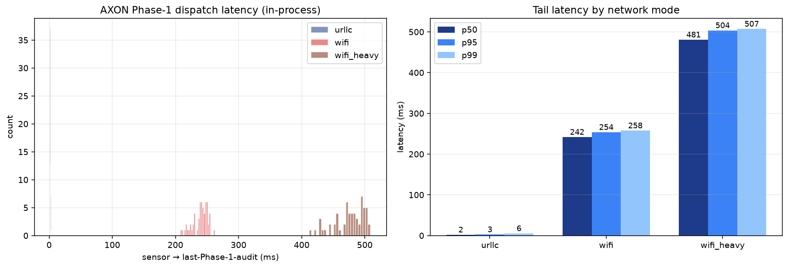
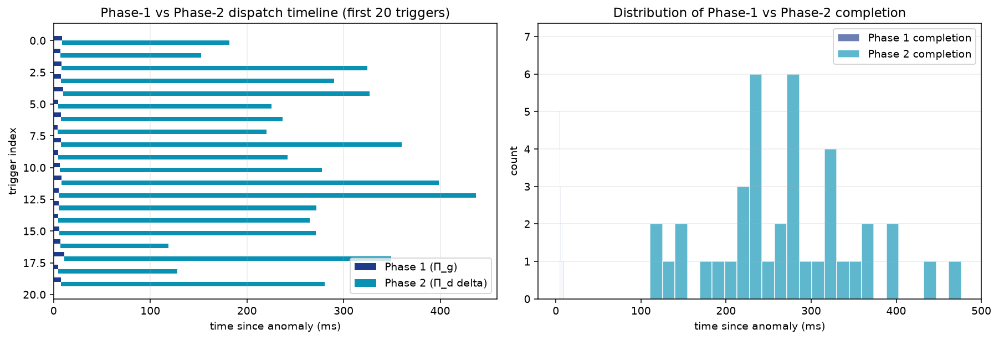
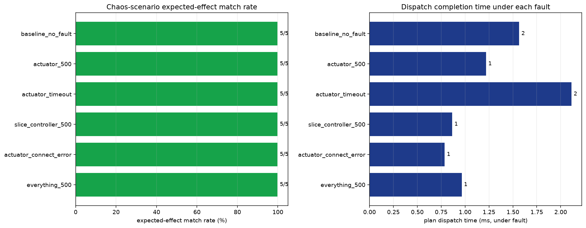
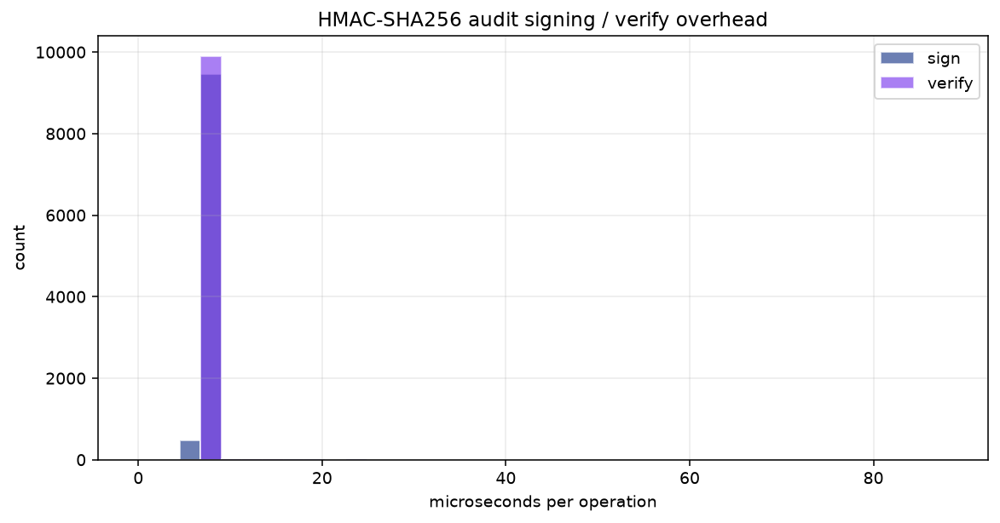
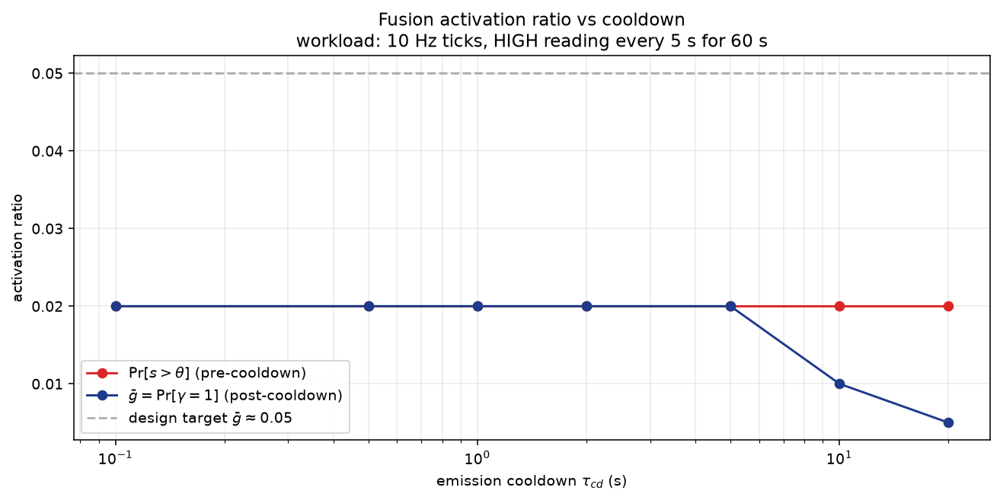
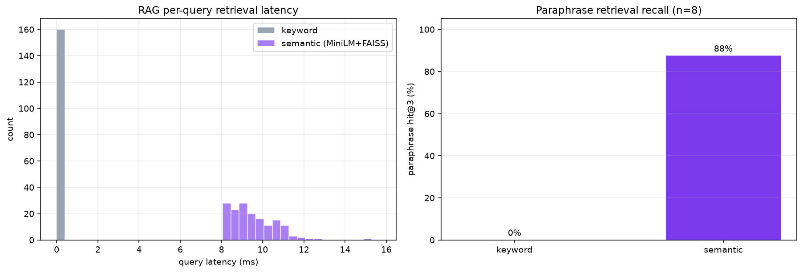

# AXON Benchmark Report
_generated 2026-08-20T06:34:49.136800+00:00_

In-process reproduction of every result claim the paper makes. No Docker, no Redis: benchmarks instantiate the real services (`ActionDispatcher`, `FusionEngine` rule evaluator, `KnowledgeBase`) and drive them through ASGI-mounted mocks for the actuator / slice endpoints. Reproduce with `python -m benchmarks.run_all`.

## 1. Phase-1 dispatch latency by network mode
| mode | n | p50 (ms) | p95 (ms) | p99 (ms) | mean (ms) | actions/trigger |
|------|---:|---------:|---------:|---------:|----------:|----------------:|
| `urllc` | 60 | 2.3 | 2.8 | 5.5 | 2.4 | 6 |
| `wifi` | 60 | 242.0 | 253.9 | 257.9 | 239.5 | 6 |
| `wifi_heavy` | 60 | 481.0 | 503.8 | 507.4 | 475.5 | 6 |



## 2. Phase-1 vs Phase-2 completion timing
n=40 triggers, deliberative stage simulated per the projection in Sec. `sec:res-projection`.

| stage | p50 (ms) | p95 (ms) | mean audits/trigger |
|-------|---------:|---------:|--------------------:|
| Phase 1 (Π_g) completion | 6.1 | 9.8 | 6 |
| Phase 2 (Π_d delta) completion | 271.4 | 400.5 | 1 |

**Phase-2 arrives ~44× later than Phase-1 completes — confirming Π_d is off the critical path.**



## 3. Chaos / fault-injection matrix
Empirical companion to the fail-safe claims around Prop. 1. Each scenario runs a 6-action plan under a specific fault and asserts the expected `ActionEffect` per action.

| scenario | matches | dispatch time (ms) | audit_intact |
|----------|--------:|-------------------:|:------------:|
| `baseline_no_fault` | 5/5 | 1.6 | ✅ |
| `actuator_500` | 5/5 | 1.2 | ✅ |
| `actuator_timeout` | 5/5 | 2.1 | ✅ |
| `slice_controller_500` | 5/5 | 0.9 | ✅ |
| `actuator_connect_error` | 5/5 | 0.8 | ✅ |
| `everything_500` | 5/5 | 1.0 | ✅ |

**Overall: 30/30 expected-effect matches (100.0%).**



## 4. HMAC audit-signing overhead
Per-op micro-benchmark. Signing runs on the dispatcher hot path; verify runs on the persister hot path.

| operation | p50 (μs) | p95 (μs) | p99 (μs) | mean (μs) |
|-----------|---------:|---------:|---------:|----------:|
| sign    | 6.88 | 7.04 | 7.42 | 6.97 |
| verify  | 7.04 | 7.21 | 9.42 | 7.19 |

**Sign + verify round-trip at p50: 13.9 μs = ~0.0139 ms — negligible vs any per-action handler latency.**



## 5. Fusion activation ratio $\bar g$ vs cooldown
Sweep of the emission cooldown $\tau_{cd}$ against a 60 s / 10 Hz synthetic workload with a HIGH reading injected every 5 s. $\bar g$ is the Eq. (6) activation ratio.

| cooldown (s) | evaluations | over-threshold | activations | over-threshold ratio | $\bar g$ |
|-------------:|------------:|---------------:|------------:|---------------------:|---------:|
| 0.1 | 600 | 12 | 12 | 0.020 | 0.020 |
| 0.5 | 600 | 12 | 12 | 0.020 | 0.020 |
| 1.0 | 600 | 12 | 12 | 0.020 | 0.020 |
| 2.0 | 600 | 12 | 12 | 0.020 | 0.020 |
| 5.0 | 600 | 12 | 12 | 0.020 | 0.020 |
| 10.0 | 600 | 12 | 6 | 0.020 | 0.010 |
| 20.0 | 600 | 12 | 3 | 0.020 | 0.005 |



## 6. RAG retrieval: semantic vs keyword
Paraphrase queries (queries share zero keywords with the KB sections they target) evaluated on `shared/knowledge_base/`.

| backend | hit@3 | latency p50 (ms) | latency p95 (ms) | mean (ms) |
|---------|:-----:|-----------------:|-----------------:|----------:|
| semantic (MiniLM+FAISS) | 7/8 | 9.327 | 11.202 | 9.519 |
| keyword | 0/8 | 0.0264 | 0.0277 | 0.0265 |



## Reproduction
```bash
uv sync --extra dev
uv run python -m benchmarks.run_all
```
Each script is independent and writes its own CSV + PNG + JSON to `benchmarks/results/`. All benches use a fixed HMAC signing key (`AXON_AUDIT_SIGNING_KEY=bb..bb`, 64 chars) so signing overhead is reproducible across machines.
