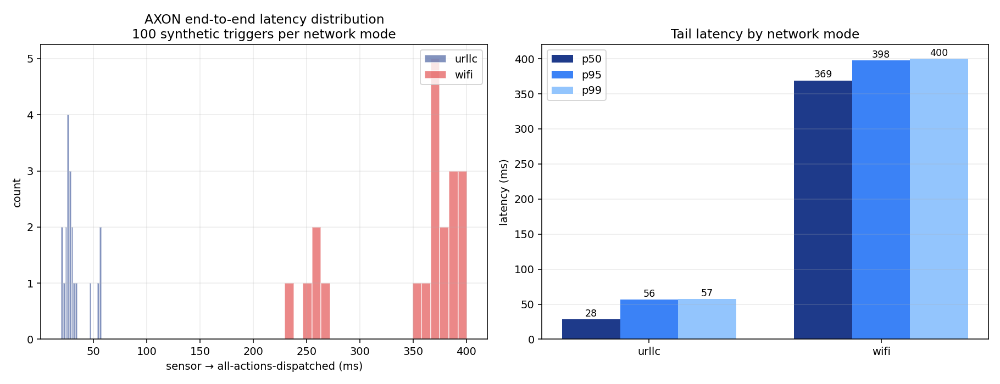

# AXON Latency Harness Report
_generated 2026-05-15T11:25:23.583922+00:00_

## Setup
100 synthetic thermal-sensor triggers per mode were injected on
`axon:sensors`. The full Layer B → C → D → 4 cascade ran for every
trigger; the harness records sensor-publish → all-six-audits-landed.

## Summary
| mode | n | p50 | p95 | p99 | min | max | mean |
|------|---:|----:|----:|----:|----:|----:|-----:|
| urllc | 20 | 28.4 ms | 56.3 ms | 57.3 ms | 19.7 ms | 57.6 ms | 32.4 ms |
| wifi | 20 | 369.1 ms | 397.6 ms | 400.2 ms | 229.4 ms | 400.8 ms | 347.8 ms |

**p50 Wi-Fi / URLLC ratio: 13.0×**

