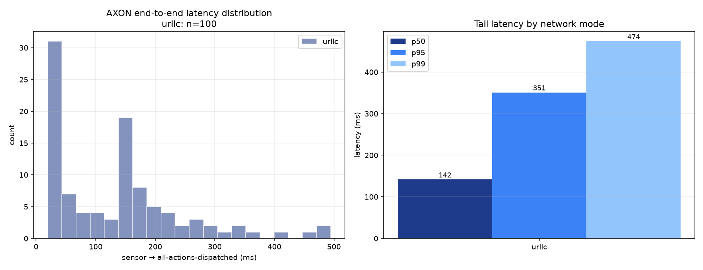

# AXON Latency Harness Report
_generated 2026-10-29T11:37:45.616364+00:00_

## Setup
100 synthetic thermal-sensor triggers requested per mode on
`axon:sensors`; `n` below counts the triggers whose six audits all
landed. The harness records sensor-publish → all-six-audits-landed,
so Layer B fusion is inside the measured window (Layer A vision is not:
the trigger is a sensor reading).

**Full AI chain** (action service `phase1_enabled=false`): every trigger waits for Layer B → C → D before dispatch.

Layers C/D run as deterministic stubs unless the stack was started
with AXON_VLM_MODE/AXON_LLM_MODE=vllm.

## Summary
| mode | n | p50 | p95 | p99 | min | max | mean |
|------|---:|----:|----:|----:|----:|----:|-----:|
| urllc | 100 | 141.6 ms | 351.0 ms | 473.9 ms | 19.6 ms | 494.6 ms | 136.4 ms |

## Gating (bar_g) per run
Measured from fusion's `/gating` endpoint before/after each mode.
`bar_g` is Pr[gamma(t)=1] — the share of evaluation ticks that
actually crossed the gate (threshold AND cooldown), i.e. the
activation ratio in Eq. (6) of the methodology.

| mode | evaluations | activations | bar_g |
|------|------------:|------------:|------:|
| urllc | 1006 | 341 | 0.339 |

